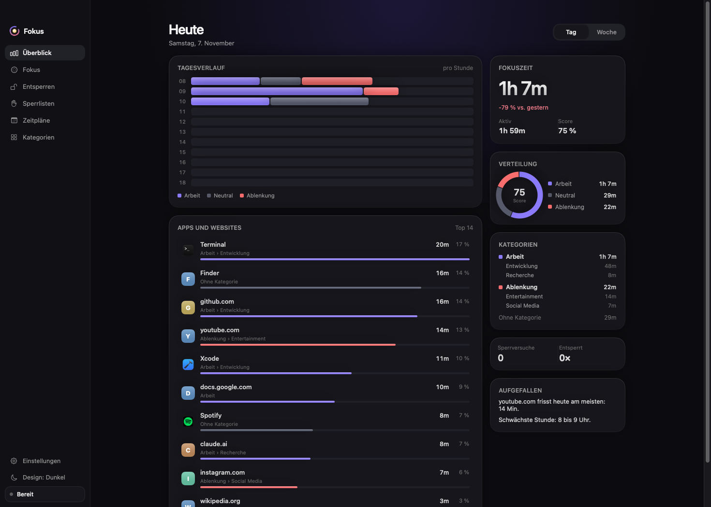
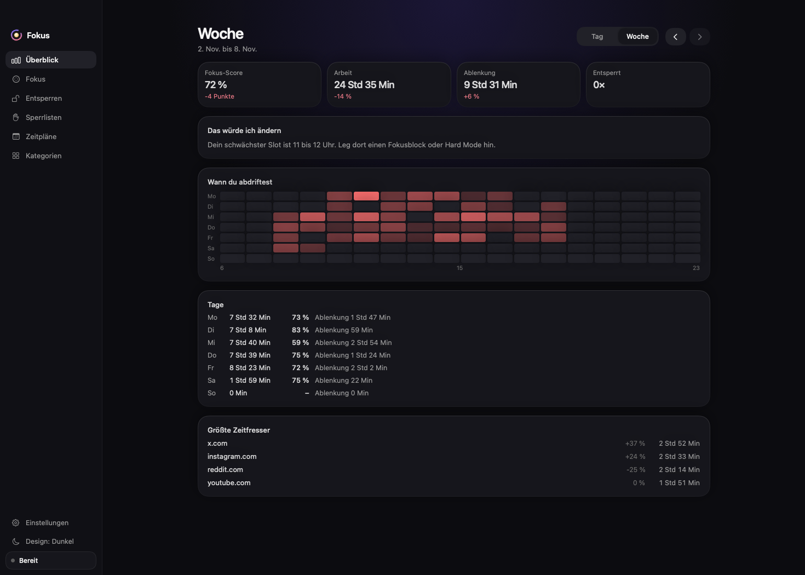
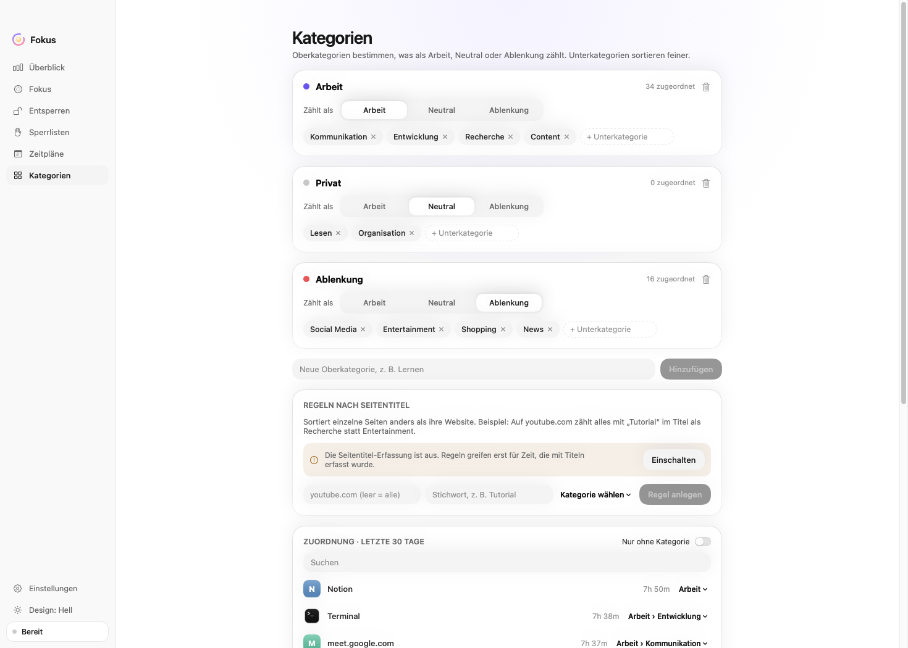

# Fokus

**A local website blocker and screen time tracker for macOS.** Fokus blocks distracting sites in Chrome, Safari and Edge without a browser extension, and shows you where your time on the Mac actually goes, per app and per website, hour by hour. No account, no cloud, no subscription. Everything stays on your Mac.

It also ships an MCP server, so Claude (or any MCP client) can read your usage data and answer questions like "When do I lose focus during the week?".

English and German, follows your Mac's language.



## Download

[**Latest release**](https://github.com/Jnooo-cloud/fokus/releases/latest) → `Fokus-<version>.dmg`

1. Open the DMG and drag Fokus into Applications.
2. Open Fokus. macOS blocks it the first time because it is not notarized yet. Close the warning with "Done".
3. System Settings → Privacy & Security → scroll down → next to "Fokus was blocked", click "Open Anyway".
4. Onboarding walks you through the browser permission, your first block list and launch at login.

Requires macOS 15 or later. Installed apps check for updates every 6 hours and install them with one click. Every update is signed, and the app rejects archives that don't match the key built into it.

## Features

**Blocking**
- Sessions with a fixed duration or until a set time, in three levels: Flexible, Commit and Hard Mode
- Schedules that start on their own, e.g. Mon to Fri, 9 to 5
- Per-subdomain exceptions: block facebook.com, keep business.facebook.com open
- Allowlist mode: everything is blocked except your exceptions
- Block apps, they get closed when opened
- Unlocking takes friction: give a reason, wait, hold. The wait grows with every unlock that day, and there is a daily limit
- Hard Mode: no quitting, no unlocking, only an emergency exit with a 5 minute wait
- Restarts itself after a crash or force quit

**Tracking**
- Time per app and per website, hour by hour, including Chrome app windows
- Focus score, daily timeline, comparison with yesterday
- Weekly report with a heatmap, your biggest time sinks and concrete suggestions
- Your own categories with subcategories, e.g. Distraction › Shopping
- Optional page titles with rules on top, e.g. "YouTube with *tutorial* in the title counts as research"
- Counts blocked attempts and stores why you unlocked
- Light and dark mode

| | |
|---|---|
|  |  |



## Talk to Claude about your screen time

Fokus includes a read-only MCP server (`fokus-mcp`). It tells the agent what it can see and how to read the numbers, so there is nothing to explain first.

| Tool | What it returns |
|---|---|
| `fokus_today` | Today hour by hour, running sessions, unlocks, blocked attempts |
| `fokus_usage` | Any date range: per day, per category, top apps and websites |
| `fokus_weekly_report` | This week against last week, biggest distractions, suggestions |
| `fokus_unlocks` | Every unlock with the reason you typed |
| `fokus_settings` | Block lists, schedules, categories, unlock rules |
| `fokus_page_titles` | Time per page title, if you turned titles on |

It also ships two prompts, `focus_coach` and `weekly_review`. In Claude Code they show up as `/mcp__fokus__focus_coach` and `/mcp__fokus__weekly_review`, in Claude Desktop under the + menu. The coach looks at when and where your focus breaks, checks that against your block lists and schedules, and gives you up to three changes to make.

Claude Code:

```bash
claude mcp add --scope user fokus -e FOKUS_BUNDLE_ID=de.jannikhiller.fokus -- /Applications/Fokus.app/Contents/MacOS/fokus-mcp
```

Claude Desktop, in `~/Library/Application Support/Claude/claude_desktop_config.json` under `mcpServers`:

```json
"fokus": {
  "command": "/Applications/Fokus.app/Contents/MacOS/fokus-mcp",
  "env": { "FOKUS_BUNDLE_ID": "de.jannikhiller.fokus" }
}
```

If you built Fokus yourself, use the bundle ID from your `.fokus-local`.

Prefer a skill? Copy [skills/fokus-coach](skills/fokus-coach) into `~/.claude/skills/`. It holds the same coaching playbook and works in any agent that reads `SKILL.md`.

There is also a chat tab inside the app ("Assistant"). It runs your installed Claude Code in the background with only the Fokus MCP attached: no terminal, no file access, no changes. You need Claude Code installed (`npm install -g @anthropic-ai/claude-code`) and logged in once.

Whatever Claude reads goes to Anthropic. That is time per app and domain, plus page titles only if you turned them on.

## Privacy

- No analytics, no third-party tracking. The app itself sends nothing over the network, except the update check against this repo's releases.
- It stores seconds per app or domain per hour, not full URLs. Page titles only if you turn them on, and you can delete them any time.
- Incognito windows are never recorded with titles.
- Website icons are letters, so no favicon request leaks your browsing.
- Data lives in `~/Library/Application Support/Fokus/`.

## How it works

Fokus reads the active tab's address through AppleScript (with your permission) every few seconds. Blocked sites get redirected to a local block page, and time gets counted per domain. There is no extension to disable and no proxy in between. Idle time (3 minutes without input) and a locked screen are not counted.

## Limits

- Blocking works while Fokus is running. Firefox can only be blocked as a whole app.
- A network filter that covers every browser exists in the code, but it needs a paid Apple Developer account and is off in this version.
- An admin who really wants to can get around it. Fokus is meant to add friction, not to be a prison.
- Tested on Apple Silicon with macOS 27 and Chrome. Safari and Edge are supported but less tested.

## Build from source

Requires macOS 15+ and Xcode or the Command Line Tools (`xcode-select --install`).

```bash
git clone https://github.com/Jnooo-cloud/fokus.git
cd fokus
echo 'FOKUS_BUNDLE_ID=com.yourname.fokus' > .fokus-local
./scripts/install-local.sh
```

The script builds the app, puts it in `/Applications/Fokus.app` and sets up a launch agent that restarts Fokus after a crash. Your own bundle ID keeps the browser permission across rebuilds.

```bash
swift test                                # core logic tests
./scripts/snapshot.sh build/shots --demo  # every screen as PNG, with demo data
./scripts/release.sh 0.3.0                # DMG plus signed update archive in dist/0.3.0
```

The core (sessions, rules, categories, reports) lives in `Sources/ZoneCore` and is tested. The app is in `Sources/Zone`, Fokus-specific parts in `Sources/Zone/Local`.

Coming from ActivityWatch? `python3 scripts/import-activitywatch.py` imports your history once.

**Uninstall** (self-built):

```bash
launchctl bootout gui/$(id -u)/$(grep -o '=.*' .fokus-local | cut -c2-)
rm ~/Library/LaunchAgents/$(grep -o '=.*' .fokus-local | cut -c2-).plist
rm -rf /Applications/Fokus.app
```

## Credits and license

Fokus is based on [Zone](https://github.com/morajabi/zone) by Mo Rajabi, which brought sessions, schedules and tab redirection. Fokus adds time tracking, reports, categories, unlock friction, Hard Mode, the MCP server, the in-app assistant, the installer and signed updates. Zone's original README is in [docs/zone-README.md](docs/zone-README.md).

MIT License, see [LICENSE](LICENSE).

---

**Deutsch:** Fokus ist ein lokaler Website-Blocker und Zeit-Tracker für den Mac, ohne Konto, ohne Cloud, ohne Browser-Extension. DMG aus dem [neuesten Release](https://github.com/Jnooo-cloud/fokus/releases/latest) öffnen, Fokus in Programme ziehen, öffnen, Meldung mit „Fertig“ schließen, dann Systemeinstellungen → Datenschutz & Sicherheit → „Dennoch öffnen“. Den Rest erklärt die App, auf Deutsch, wenn dein Mac auf Deutsch läuft.
