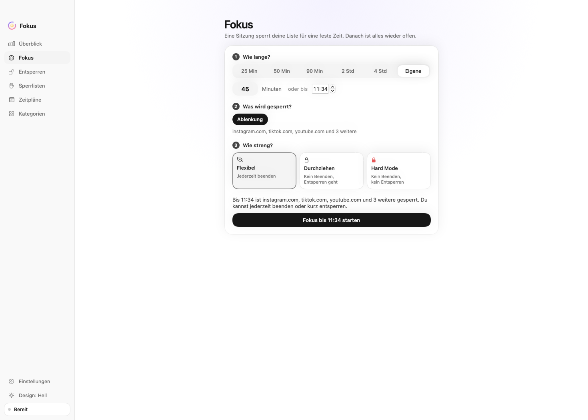

# Fokus

Fokus ist ein lokaler Website-Blocker und Zeit-Tracker für den Mac. Er sperrt Ablenkungen in Chrome, Safari und Edge, ohne Browser-Extension, und zeigt dir, wo deine Zeit am Rechner wirklich hingeht. Kein Konto, keine Cloud, kein Abo. Alles bleibt auf deinem Mac.

*English: Fokus is a local, extension-free website blocker and time tracker for macOS. The interface is German for now.*


## Was Fokus kann

**Sperren**
- Sitzungen mit fester Dauer oder bis zu einer Uhrzeit, drei Stufen: Flexibel, Durchziehen, Hard Mode
- Zeitpläne, die von selbst starten, zum Beispiel Mo bis Fr von 9 bis 17 Uhr
- Ausnahmen pro Subdomain: facebook.com gesperrt, business.facebook.com offen
- Nur-erlaubte-Seiten-Modus: alles gesperrt außer deinen Ausnahmen
- Apps sperren, sie werden beim Öffnen geschlossen
- Entsperren mit Reibung: Grund angeben, warten, halten. Die Wartezeit wächst mit jeder Freigabe am Tag, dazu gibt es ein Tageslimit
- Hard Mode: kein Beenden, kein Entsperren, nur ein Notausgang mit 5 Minuten Wartezeit
- Startet nach einem Absturz oder Sofort-Beenden von selbst neu

**Verstehen**
- Zeit pro App und pro Website, Stunde für Stunde
- Fokus-Score, Tagesverlauf, Vergleich mit gestern
- Wochenbericht mit Heatmap, Zeitfressern und konkreten Vorschlägen
- Eigene Kategorien mit Unterkategorien, zum Beispiel Ablenkung › Shopping
- Optional Seitentitel speichern und Regeln danach, zum Beispiel „YouTube mit Tutorial im Titel zählt als Recherche“
- Zählt Sperrversuche und speichert, warum du entsperrt hast
- Helles und dunkles Design

| | |
|---|---|
|  |  |


## Datenschutz

- Keine Analyse, kein Tracking durch Dritte, keine Netzwerkanfragen außer an deinen eigenen Browser.
- Gespeichert werden Sekunden pro App oder Domain und Stunde, keine vollen Adressen. Seitentitel nur, wenn du sie einschaltest, und du kannst sie jederzeit löschen.
- Inkognito-Fenster werden nie mit Titel erfasst.
- Website-Icons sind Buchstaben, damit keine Favicon-Anfrage dein Surfverhalten verrät.
- Daten liegen in `~/Library/Application Support/Fokus/`.

## Installation

Fokus ist noch nicht von Apple notarisiert. Du baust es selbst, das dauert ein paar Minuten.

Voraussetzungen: macOS 15 oder neuer und die Command Line Tools (`xcode-select --install`). Xcode brauchst du nicht.

```bash
git clone <dieses-repo> fokus
cd fokus
echo 'FOKUS_BUNDLE_ID=com.deinname.fokus' > .fokus-local
./scripts/install-local.sh
```

Das Skript baut die App, legt sie nach `/Applications/Fokus.app` und richtet einen Autostart ein, der Fokus nach einem Absturz neu startet. Danach Fokus öffnen, unter Einstellungen → Websites deinen Browser verbinden und die macOS-Abfrage erlauben.

Eine eigene App-Kennung in `.fokus-local` sorgt dafür, dass macOS die Browser-Freigabe bei Updates behält.

**Updaten:** `git pull` und `./scripts/install-local.sh` nochmal ausführen.

**Entfernen:**

```bash
launchctl bootout gui/$(id -u)/$(grep -o '=.*' .fokus-local | cut -c2-)
rm ~/Library/LaunchAgents/$(grep -o '=.*' .fokus-local | cut -c2-).plist
rm -rf /Applications/Fokus.app
```

Deine Daten in `~/Library/Application Support/Fokus/` löschst du bei Bedarf selbst.

**Von ActivityWatch umsteigen:** Läuft ActivityWatch bei dir, holt `python3 scripts/import-activitywatch.py` die Historie einmalig rüber.

## Grenzen

- Die Sperre liest Tab-Adressen und leitet um. Sie greift, solange Fokus läuft, und Firefox lässt sich nur als ganze App sperren.
- Ein Netzwerkfilter, der wirklich jeden Browser erfasst, ist im Code angelegt, braucht aber einen bezahlten Apple-Developer-Account und ist in dieser Version aus.
- Wer Admin ist und es darauf anlegt, kommt drum herum. Fokus soll Reibung erzeugen, kein Gefängnis sein.
- Getestet auf Apple Silicon mit macOS 27 und Chrome. Safari und Edge sind unterstützt, aber weniger getestet.

## Entwicklung

```bash
swift test                                # Tests der Kernlogik
./scripts/install-local.sh                # bauen und installieren
./scripts/snapshot.sh build/shots --demo  # alle Seiten als PNG, mit Beispieldaten
```

Der Kern (Sitzungen, Regeln, Kategorien, Auswertung) liegt in `Sources/ZoneCore` und ist getestet. Die App liegt in `Sources/Zone`, Fokus-eigene Teile in `Sources/Zone/Local`.

## Herkunft und Lizenz

Fokus basiert auf [Zone](https://github.com/morajabi/zone) von Mo Rajabi, das Sitzungen, Zeitpläne und die Tab-Umleitung mitbringt. Die ursprüngliche README liegt in [docs/zone-README.md](docs/zone-README.md).

MIT-Lizenz, siehe [LICENSE](LICENSE).
